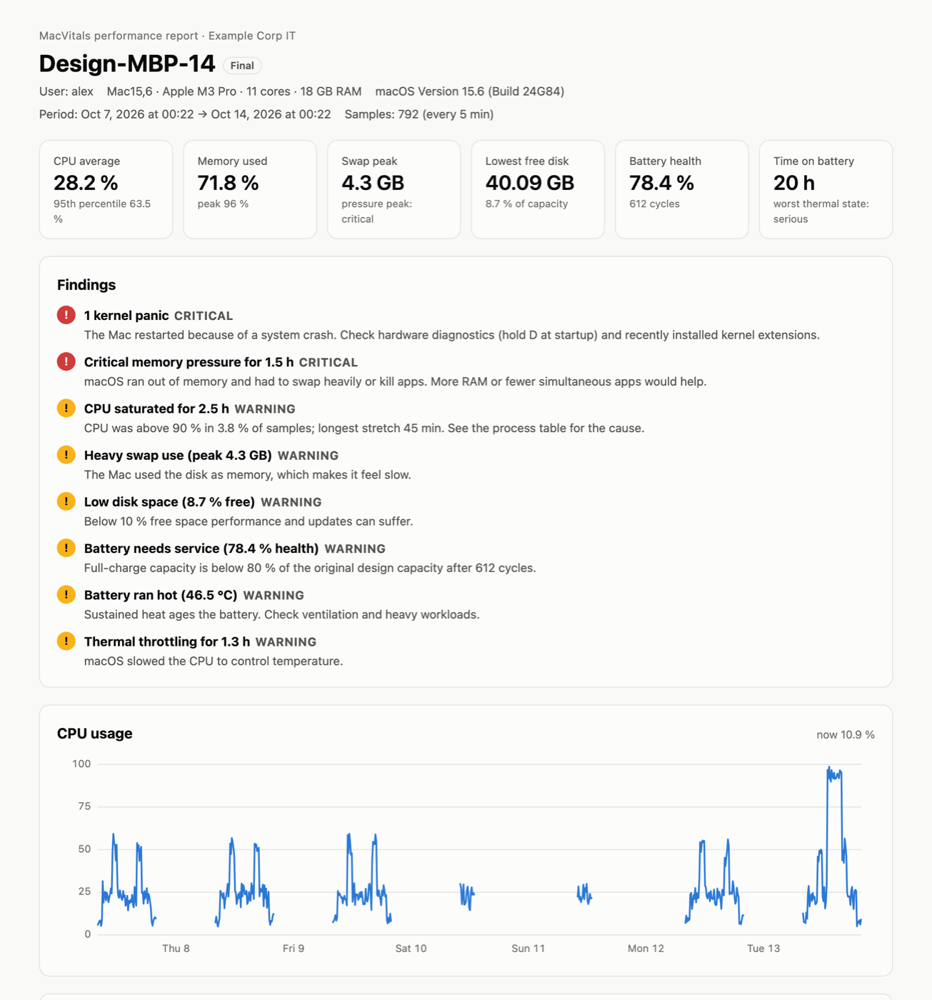
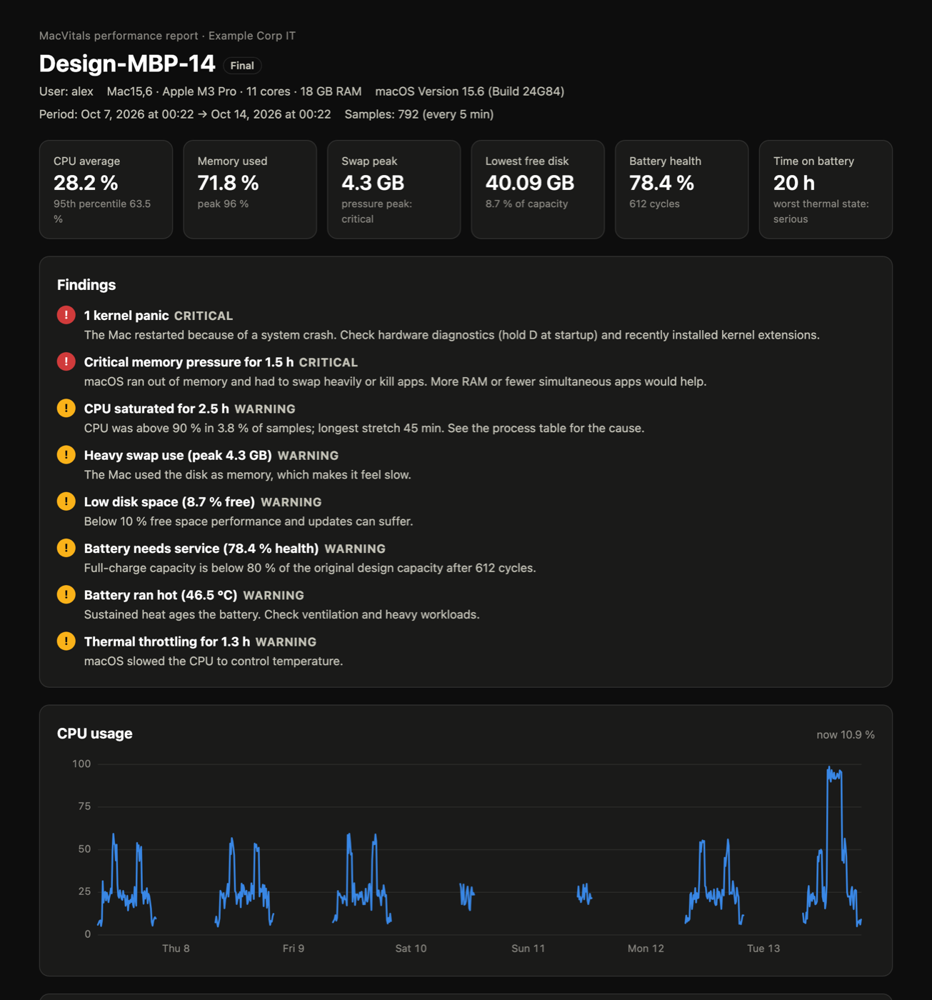
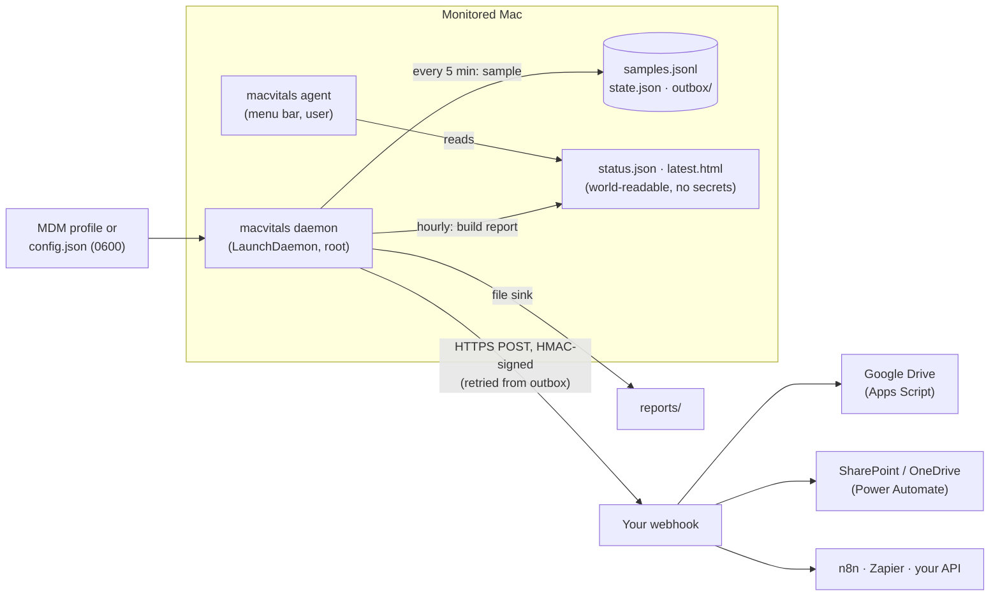

# MacVitals

**Time-boxed, privacy-respecting performance monitoring for Macs, built for IT support.**

A user says *"my Mac is slow"*. Instead of guessing, IT installs MacVitals for a week. It
samples the machine's vitals every few minutes, sends an hourly HTML report with charts and
plain-language findings, tells the user exactly what is happening, and removes itself when done.

[](https://github.com/lautisen/macvitals/actions/workflows/ci.yml)


<p align="center">
  
  
</p>

**[See a full sample report →](docs/demo-report.html)** (download and open it; it is a single offline HTML file)

## Features

- **One-week diagnosis, zero babysitting.** Install, walk away, read the report. The session ends
  on its own, delivers a final report and uninstalls itself (or runs indefinitely, if configured).
- **Findings, not just graphs.** A rule engine turns raw samples into actionable findings:
  sustained CPU saturation, memory pressure and swap, nearly-full disks, worn batteries, thermal
  throttling, kernel panics, and the process responsible.
- **A report that works anywhere.** One self-contained HTML file: SVG charts with hover tooltips,
  dark mode, print styles, mobile layout, and the raw data embedded as a CSV download. No CDN, no JS libraries.
- **Deliver anywhere.** Reports are written locally and optionally POSTed to a webhook, with
  ready-made receivers for **Google Drive** (Apps Script), **SharePoint/OneDrive** (Power Automate),
  n8n/Make/Zapier or your own server. Requests are **HMAC-signed**, and an **offline outbox**
  retries after network drops and reboots. No cloud credentials ever live on the Macs.
- **Transparent to the user.** A menu bar icon shows that monitoring is on, until when, by whom,
  and opens the **exact report IT receives**. See [PRIVACY.md](docs/PRIVACY.md).
- **Built for fleets.** Configure through MDM (Jamf, Intune, Kandji…) with a configuration profile.
  The installer package contains **no secrets**, so it can be shared freely.
- **Native and light.** Universal binary (Apple silicon + Intel), no dependencies, runs at low
  priority, reads metrics straight from Mach, IOKit and `sysctl`.

## How it works



| Component | Role |
|---|---|
| `MacVitalsCore` | Library: collectors, statistics, insight rules, report rendering, delivery. Everything testable lives here. |
| `macvitals daemon` | Samples on a continuous clock (catches up after sleep), builds reports, ends the session. |
| `macvitals agent` | `NSStatusItem` notice for the logged-in user. Reads only a secret-free status file. |
| `macvitals` CLI | `status`, `report`, `send-test`, `config`, `sample`, `demo-report`, `uninstall`. |
| `scripts/build.sh` | Universal binary → app bundle → `.pkg`, with optional Developer ID signing and notarization. |

## Quick start

Try it without installing anything:

```bash
git clone https://github.com/lautisen/macvitals && cd macvitals
swift run macvitals demo-report --open     # synthetic week of data
swift run macvitals sample                 # one live measurement of this Mac
```

Build and install:

```bash
scripts/build.sh                            # → build/MacVitals-0.1.0.pkg
sudo installer -pkg build/MacVitals-0.1.0.pkg -target /
macvitals status
```

For real deployments, sign and notarize (`DEVELOPER_ID_APP`, `DEVELOPER_ID_INSTALLER`,
`NOTARY_PROFILE`; see the header of [`build.sh`](scripts/build.sh)) and push the `.pkg` with your MDM.

## Where reports go

| Platform | How | Guide |
|---|---|---|
| Google Drive | Apps Script web app (free) | [`examples/google-drive/Code.gs`](examples/google-drive/Code.gs) |
| SharePoint / OneDrive | Power Automate flow | [docs/destinations.md](docs/destinations.md#sharepoint--onedrive-power-automate) |
| Dropbox, Box, S3, Slack, Notion… | n8n / Make / Zapier | [docs/destinations.md](docs/destinations.md#n8n--make--zapier) |
| Your own server | Any HTTPS endpoint | [`examples/receiver/receiver.py`](examples/receiver/receiver.py) |

## Configuration

Defaults work out of the box (local reports only). Settings are layered:
**built-in defaults → `/Library/Application Support/MacVitals/config.json` → MDM managed preferences**.

| Key | Default | |
|---|---|---|
| `monitoringDays` | `7` | Session length. `0` = until uninstalled. |
| `autoUninstall` | `true` | Remove MacVitals after the final report. Reports are kept. |
| `sampleIntervalSeconds` / `reportIntervalSeconds` | `300` / `3600` | |
| `organizationName`, `supportContact` | | Shown to the user and in the report. |
| `showNotice` | `true` | One-time explanation for the user. |
| `collectProcessNames` | `true` | Set `false` to record no process names at all. |
| `reportDirectory` | `…/MacVitals/reports` | Local copy of every report (`root:admin`, `0640`). |
| `webhook.url` / `.secret` / `.headers` / `.signatureInQuery` | | See [docs/destinations.md](docs/destinations.md). |

Examples: [`config.example.json`](examples/config.example.json),
[`MacVitals.mobileconfig`](examples/MacVitals.mobileconfig). Check the effective result with
`sudo macvitals config` (secrets masked).

## Security & privacy

- No secrets in the package; the build fails if a config file sneaks into the payload.
- Root-only storage for secrets and raw data; the user-facing agent never sees them.
- HMAC-SHA256 request signing with replay protection; HTTPS enforced.
- Machine-provided strings are HTML-escaped; no shell interpolation anywhere.
- Standard macOS installer: no home-made password dialogs.

Details in [SECURITY.md](SECURITY.md) and [PRIVACY.md](docs/PRIVACY.md).

## Development

```bash
swift test                                  # 38 tests: parsers, rules, rendering, signing, outbox
MACVITALS_HOME=/tmp/mv swift run macvitals daemon   # full daemon, no root, nothing installed
```

See [CONTRIBUTING.md](CONTRIBUTING.md) for an end-to-end run against the local signed
webhook receiver in [`examples/receiver`](examples/receiver/receiver.py).

## Roadmap

- Foreground-app usage time (from the agent, opt-in)
- Localized reports (Spanish first)
- Unexpected-shutdown detection from the unified log
- Native S3-compatible upload (S3, R2, B2, GCS) with write-only keys
- Slack / Teams alerts for critical findings
- Fleet dashboard aggregating webhook payloads

## License

[MIT](LICENSE)
